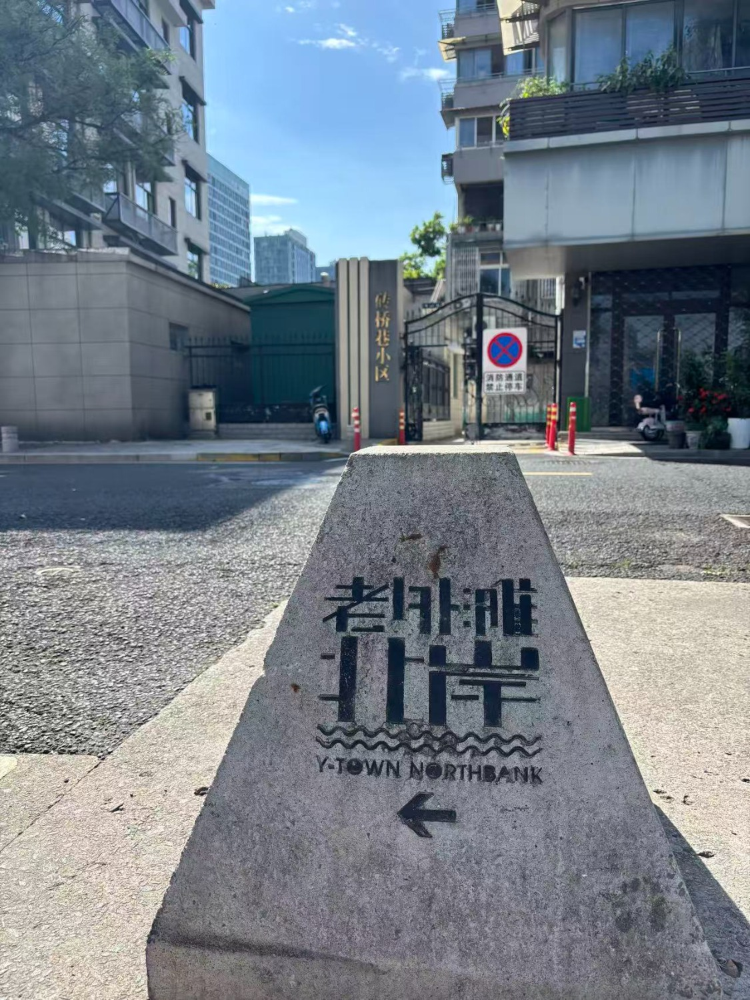
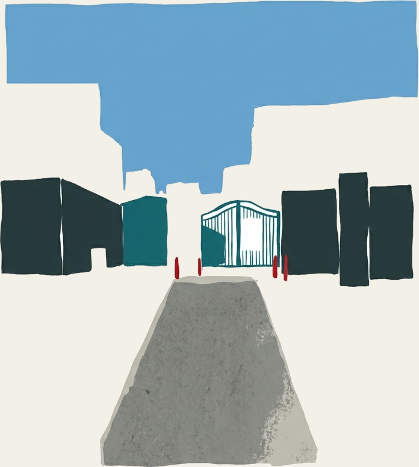
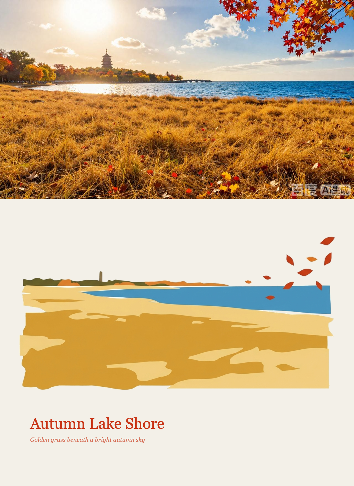

# Photo Editorial Studio

**Photo Editorial Studio** is a local-first browser app for turning photographs into editorial posters. It pairs an unchanged photograph with a small, separate abstract motif, or makes a shape-preserving limited-colour poster directly in the browser.

The interface is in Chinese. The app runs on your computer; AI-backed features use services that you configure yourself.

## Examples

The following examples were supplied for this project. They are included as provided, including visible watermarks; they have not been retouched.

### Street entrance: source photo



### Street entrance: abstract motif



### Autumn lake: composed editorial poster



The supplied examples are for project demonstration. Their redistribution rights have not been independently verified; see [source and asset notes](SOURCE_ATTRIBUTION.md) before publishing publicly.

## Features

- **Photography + abstract editorial:** analyzes a photo, generates a separate abstract motif, removes only border-connected near-white background pixels, and composes the poster locally. The original photograph is not redrawn by the image generator.
- **Shape-preserving colour poster:** smooths fine texture and quantizes the photograph into a limited palette in the browser. AI colour and copy suggestions are optional.
- **Local composition controls:** adjust layout, motif scale, paper colour, title, subtitle, and print texture without another model request.
- **PNG export:** export the current poster from the browser.
- **Local-first workflow:** selecting and processing photos in the colour-poster mode stays in the browser. AI requests send a compressed preview only after the user starts an AI feature.

## Requirements

- Node.js 20 or newer
- For AI analysis and optional colour/copy suggestions: a service compatible with the Anthropic Messages API, with image input and streaming text output
- For the abstract editorial workflow: `mcode-tools` available on `PATH`, plus an image-generation connector configured for the `connector__matrix__generate_image` operation

The project does not bundle model providers, credentials, connectors, or `mcode-tools`. Their installation, configuration, terms, and account usage are managed separately. The non-AI colour-poster workflow can be used without configuring the AI services.

## Run locally

1. Copy the environment template:

   ```sh
   cp .env.example .env
   ```

2. Set the following values in `.env` for AI-backed features:

   - `COLLAGE_API_BASE_URL`: base URL of the Anthropic Messages-compatible service. The app appends `/messages`; a URL ending in `/v1` is supported.
   - `COLLAGE_API_KEY`: API key for that service.
   - `COLLAGE_MODEL`: model name accepted by that service.
   - `COLLAGE_PROVIDER`: optional label displayed in the app.
   - `PORT`: optional local port; defaults to `8787`.

   Keep real credentials in `.env` or your process environment. Do not commit them.

3. Start the server:

   ```sh
   npm start
   ```

4. Open <http://127.0.0.1:8787>.

The server binds to loopback (`127.0.0.1`) and only accepts the configured local Host values. It has no production deployment or authentication layer and should not be exposed to a public network.

## Verify

```sh
npm run check
npm test
```

Tests use mock model responses and a fake CLI executable; they do not call a live model or image-generation service. A successful test run verifies local parsing, image processing, composition, and selected API behaviors, but does not verify external provider credentials, connector availability, or live image generation.

## How image processing works

1. The browser checks the selected file's PNG, JPEG, or WebP signature before decoding it. Files above 30 MB or 80 megapixels are rejected.
2. AI features create a JPEG preview with a longest edge of at most 1500 pixels. Editorial analysis sends that preview to the configured vision service. Motif generation sends it to the local `mcode-tools` workflow, which may upload it to a temporary HTTPS asset URL for the configured connector.
3. The generated motif is cleaned in the browser. Only near-white pixels connected to its outer edge are removed; enclosed white marks are retained.
4. The browser composes the original photo, motif, and typography, then exports the result locally.
5. In colour-poster mode, smoothing, palette extraction, and composition run in the browser. Only the optional AI suggestion action sends a compressed preview.

External services may process, retain, or log submitted images according to their own policies, and may incur account usage. Do not submit sensitive images unless you have reviewed the configured services and have permission to do so. AI results may be inaccurate; review generated text and imagery before use.

## Project contents

- `server.js`: loopback-only static server and API routes
- `lib/`: environment loading, vision API integration, and motif-generation workflow
- `public/`: browser UI, local image processing, and poster composition
- `test/`: Node.js built-in test suite
- `docs/images/`: supplied project demonstration images
- `.env.example`: credential-free configuration template

There are no npm package dependencies or lockfile. Runtime tools and AI services are configured separately as described above.

## Source, asset, and license status

The exact upstream GitHub skills or code referenced during development, their source files, and their licenses were not identified in the supplied project. No source URLs, `LICENSE`, or third-party notices were present in the extracted project. This is recorded in [SOURCE_ATTRIBUTION.md](SOURCE_ATTRIBUTION.md); no upstream authorship or license has been guessed.

**Before making a public release, identify and review each upstream source and its license/attribution requirements, and confirm the redistribution rights for the supplied example images.** This project currently has no `LICENSE` file, so no open-source license is granted by this repository. Do not represent it as cleared for public reuse until those checks are complete.
